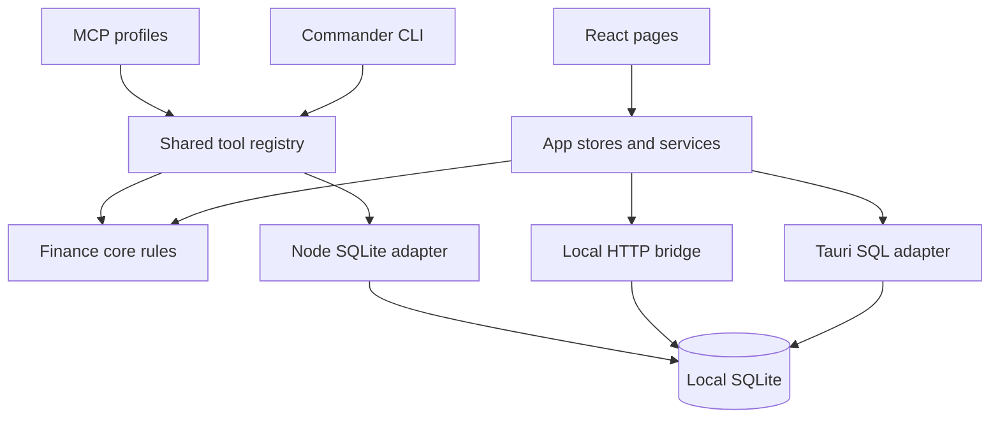

# Architecture

Shikin is a local-first React/TypeScript application with a Tauri desktop shell,
a local SQLite database, an optional loopback web host, and CLI/MCP automation.
This reference describes the current implementation. Earlier `sql.js` / IndexedDB
architecture notes have been replaced; those are not the current storage model.

## Runtime and ownership

`packages/finance-core` owns shared financial projection, validation, migration,
and evidence contracts. Runtime adapters own I/O and transaction boundaries.
React pages use stores/services through `src/lib/database.ts`; they do not call
MCP. CLI and MCP reuse the registry in `cli/src/tools/index.ts` and the same domain
handlers. Specialized app and CLI adapters are tested for financial parity.

| Area                                        | Principal implementation                                  |
| ------------------------------------------- | --------------------------------------------------------- |
| App routes, native appearance, localization | `src/App.tsx`, `src/components/layout/`, `src/i18n/`      |
| App database and atomic services            | `src/lib/database.ts`, domain services in `src/lib/`      |
| Native bootstrap                            | `src-tauri/src/lib.rs`, Tauri SQL/FS/store plugins        |
| Development / hosted bridge                 | `scripts/data-server.mjs`, `cli/src/web-host.ts`          |
| CLI schemas and execution                   | `cli/src/cli.ts`, `cli/src/tools/`                        |
| MCP registration and permissions            | `cli/src/mcp-server.ts`, `cli/src/mcp-profiles.ts`        |
| Shared ledger and financial rules           | `packages/finance-core/src/`                              |
| Backup, readiness, and SQLite access        | `cli/src/database.ts`, `src/lib/database.ts`, data server |

## Storage lifecycle

The app-data path is platform-specific and shared by installed app, CLI, and MCP.
The native app and local data server initialize and migrate it. CLI/MCP require
an existing compatible schema. `app_data_state` carries an opaque database
identity and monotonic financial data revision used by previews and cursors.

Migration definitions for newer financial features are shared through
finance-core. The native JavaScript adapter, hosted data server, test migrator,
and CLI readiness checks use those definitions. Migrations 025 and 026 add budget
history and receivable evidence; they do not create financial transactions or
infer missing historical budgets. See [upgrade notes](AGENT-WORKFLOWS-UPGRADE.md).

App settings and notebooks also use local storage/files; a database snapshot
alone is not a complete machine setup backup. Development and benchmarks use
new disposable data directories by default. Financial test fixtures must never
be pointed at an installed user's database.

## Financial invariants

Money is stored as safe integer centavos and converted at explicit API/display
boundaries. Exact decimal FX evidence and missing-rate completeness travel with
financial projections. Native-currency totals are not silently mixed.

Gross cashflow, net consumption, and recurring estimates are separate report
bases. Category/subcategory describes a transaction; budget scopes select
accounts, categories, and tags with inclusions/exclusions. Net calculations
require appropriate classifications and independent source coverage. Transaction
date extrema do not prove statement coverage. Incomplete results preserve known
subtotals while authoritative totals and remaining amounts can be null.

One-off transfers and credit-card payment evidence preserve both bank sides
without counting an internal movement twice. Pending and staged rows retain their
balance policy until explicitly settled/finalized. Metadata corrections preserve
money, bank identifiers, dates, and original import evidence. Split allocations
sum exactly to the source amount and respect economic-classification dependencies.

Budget-history captures preserve configuration, both reporting bases, and source
evidence. Corrections append an expected revision; edits to the current plan do
not rewrite history. Missing captures stay missing; a past period reconstructed
today is explicitly labeled. Virtual bucket reserves do not create expenses.

Expected receivables are plans. Received amounts equal the preserved unattributed
baseline plus active links to ordinary posted/cleared income. Installments and
link reversals do not create or delete bank income. Protected source evidence
cannot be changed until the active relationship is explicitly corrected.

## Transactions, audit, and retries

Domain services validate and write under one database transaction. The synchronous
Node adapter uses `BEGIN IMMEDIATE` and savepoints for nested work; promises must
not escape a better-sqlite3 transaction callback. Browser services use the existing
server transaction lease and check final committed/rolled-back status.

The metadata batch first validates every row, then commits all corrections,
per-row audits, and a retry receipt in `audit_log` together. Its preview is bound
to exact intent and database revision. Budget-history records and receipt links
carry domain-specific evidence and concurrency checks. These mechanisms extend
existing workflows instead of adding a second ledger or generic operation engine.

Recovery is domain-specific: supported ordinary writes can use `undo`; metadata
uses a new correction; history uses a new revision; payment links are voided;
virtual allocations are reversed. A SQLite restore validates a snapshot and
preserves a rollback copy before replacement. Restores remain an advanced workflow.

## MCP architecture

Full is the compatibility default. Core is a fixed opt-in everyday catalog, and
read-only independently restricts either profile to audited built-in reads.
Read-only excludes local plugins and unknown effects. The standalone entrypoint
also opens SQLite read-only, skips migration/preparation, and denies backup or
restore writes. Embedded hosts configure their database access separately.

MCP registers complete strict input objects, a common output envelope, compact
JSON fallback text, structured results, and conservative effects annotations.
`shikin://capabilities` reports the fixed profile. Stored financial text is data,
never agent instructions. A compatible host may use deferred tool search; the
server does not expose SQL, arbitrary commands, or a call that widens permissions.

See the [MCP architecture decision](../research/MCP-DESIGN.md),
[generated inventory](../reference/MCP-TOOL-INVENTORY.md), and
[benchmarks](../benchmarks/MCP-BENCHMARKS.md) for measured tradeoffs and limits.
The locked SDK retains its existing protocol negotiation; researching a newer
specification does not imply a transport-version upgrade.

## Network and delivery boundaries

Core records stay local. Optional exchange-rate/market providers and external
AI clients have their own network behavior. The bridge and packaged web host
bind to loopback and enforce their local origin/authentication rules; private
remote hosting is an explicit deployment choice. No mandatory cloud account or
embedded chat assistant is introduced.

CI checks lint/types/format, migrations and domain tests, inventory drift, app/CLI
builds, packaged transport behavior, and browser workflows. The synthetic MCP
benchmark measures real tool transport and financial invariants independently
from live-model accuracy. See [Backend map](../reference/BACKEND-MAP.md) and
[Frontend map](../reference/FRONTEND-MAP.md) for detailed entry points.
